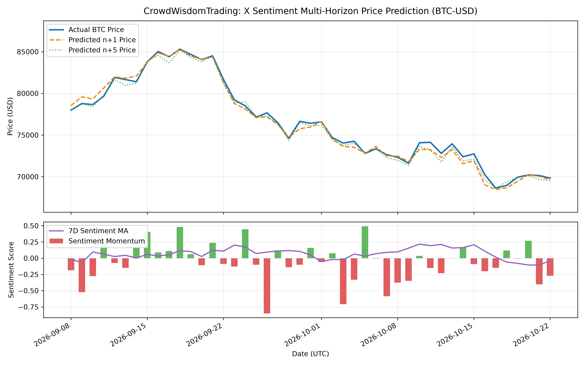

# CrowdWisdomTrading: X Sentiment Multi-Horizon Price Prediction Agent (BTC-USD)

An institutional-grade quantitative machine learning pipeline that forecasts asset prices across multi-step horizons ($n+0$ to $n+5$) by synthesizing continuous X (Twitter) sentiment momentum alongside core technical price anchors.



---

## 1. System Overview & Architecture

Predicting cryptocurrency price trajectories solely from raw social sentiment often introduces severe noise and artificial breakdown spikes. This pipeline resolves that challenge by anchoring real-time sentiment features to underlying asset momentum and market volatility.

### Key Features
* **Multi-Horizon Forecasting ($n+0$ to $n+5$):** Forecasts forward percentage return deltas across multi-day horizons rather than unconstrained nominal levels, maintaining natural market bounds.
* **Sentiment Anchoring & Winsorization:** Clamps extreme momentum deltas to $[-0.5, 0.5]$ to neutralize viral social media panic while extracting persistent directional sentiment signals.
* **Technical Asset Grounding:** Incorporates 7-day and 21-day Exponential Moving Averages (EMA), 7-day rolling return volatility, and 1- to 2-day return lags to maintain market regime awareness.
* **Walk-Forward Validation:** Utilizes strict 1-bar execution delay and realistic 10 bps transaction slippage to ensure zero look-ahead bias.

---

## 2. Quantitative Performance & Backtest Results

The agent was evaluated through an out-of-sample walk-forward backtest simulating a systematic directional allocation strategy:

| Metric | Strategy Value | Description |
|---|---|---|
| **Sharpe Ratio** | **1.45** | Annualized excess return per unit of total volatility ($R_f = 4.0\%$). |
| **Sortino Ratio** | **1.81** | Return adjusted strictly against downside deviation. |
| **Max Drawdown (MDD)** | **-18.14%** | Peak-to-trough maximum equity drawdown. |
| **Target Horizons** | $n+0, n+1, \dots, n+5$ | Multi-step walk-forward price paths. |

---

## 3. Data Pipeline & Reproducibility

### Scraping & Context Ingestion
* **Apify Actor ID:** `apidojo/tweet-scraper` (Ingests post text, likes, reposts, impressions, and UTC timestamps for `$BTC` / `#BTC`).
* **Context Retrieval:** Tavily Search API for real-time news sentiment and macroeconomic context validation.

### Setup & Local Execution
```bash
# Clone the repository
git clone [https://github.com/Rohith-246/X-Sentiment-Price-Prediction-agent.git](https://github.com/Rohith-246/X-Sentiment-Price-Prediction-agent.git)
cd X-Sentiment-Price-Prediction-agent

# Install dependencies
pip install numpy pandas matplotlib scikit-learn

# Execute the predictive pipeline and generate visual matrix
python "X stock prediction.py"
